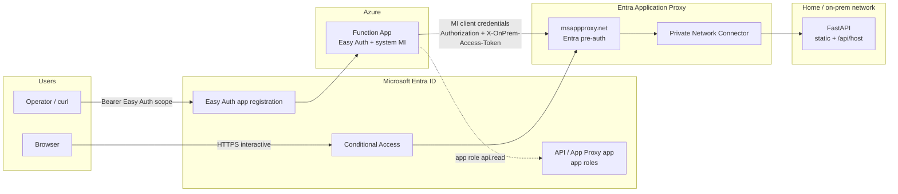
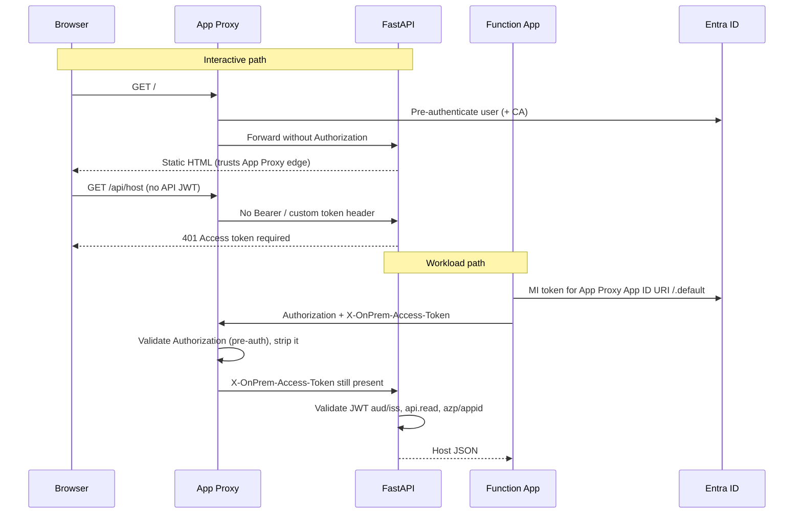

# project-app-proxy

Hands-on hybrid identity lab: an on-premises FastAPI app published through **Microsoft Entra Application Proxy**, called by an **Azure Functions** (Flex Consumption) app using **Easy Auth** inbound and a **system-assigned managed identity** outbound, with **Conditional Access** defined as **Entra UTCM** desired state.

The lab explores how interactive (browser) and non-interactive (workload) paths differ under Entra pre-authentication, app roles, and Conditional Access.

## Current state

| Area | Status |
|------|--------|
| On-prem FastAPI (`on-prem-app`) | Implemented — static site + `GET /api/host` |
| Entra Application Proxy publish | Working E2E (`msappproxy.net`) |
| Local Azure Function → App Proxy | Working (e.g. `azd auth login` / DAC) |
| Azure Function infra (Bicep + deploy) | Implemented — Flex Consumption, Python 3.14, Easy Auth, MI storage |
| Function → App Proxy → `/api/host` (Azure) | Verified with Easy Auth token + MI dual-header call |
| On-prem JWT + `api.read` + `ALLOWED_AZP` | Implemented |
| Conditional Access Policy A (UTCM) | Deployed — CA report-only + UTCM monitor registered |

## Repository layout

```text
project-app-proxy/
├── on-prem-app/          # FastAPI "on-prem" API + static UI
│   ├── src/              # main, auth, config, api/host
│   └── static/
├── function-app/         # Azure Functions Python v2 programming model
└── infra/
    ├── main.bicep        # Flex Consumption Function + storage + Easy Auth
    ├── deploy.ps1        # Easy Auth app reg, Bicep deploy, MI → api.read
    └── utcm/             # Conditional Access as UTCM baseline + monitor
```

## Architecture



### Auth split (important)



| Surface | Gate |
|---------|------|
| Browser → App Proxy `/` | Entra pre-auth (+ Conditional Access when enforced) |
| Browser → App Proxy `/api/host` | On-prem requires JWT — **expected 401** without dual-header token |
| Operator → Function `/api/onprem-host` | Easy Auth (Function’s own app audience) |
| Function → App Proxy `/api/host` | MI token; App Proxy edge + on-prem JWT/`api.read`/`ALLOWED_AZP` |

**Why a custom header?** With App Proxy pre-auth set to `Microsoft Entra ID`, the `Authorization` header is consumed for edge auth and **not** forwarded to the backend. The Function sends the same access token in `Authorization` and `X-OnPrem-Access-Token`; FastAPI reads the custom header after the proxy strips Bearer.

## Components

### On-prem app (`on-prem-app`)

| Item | Detail |
|------|--------|
| Runtime | Python, FastAPI + Uvicorn |
| Routes | `GET /`, `/static/*`, `GET /healthz`, `GET /api/host` |
| Auth off | `LOCAL_DEBUG=true` (default) skips JWT checks |
| Auth on | JWT from `Authorization` or `X-OnPrem-Access-Token`; role `api.read`; caller allowlist `ALLOWED_AZP` |

Environment variables (when auth is enabled):

| Variable | Purpose |
|----------|---------|
| `LOCAL_DEBUG` | `false` to enforce auth |
| `TENANT_ID` | Entra tenant GUID |
| `API_AUDIENCE` | Token `aud` — use the App Proxy Application ID URI (often the external `https://<app>.msappproxy.net` URL) |
| `REQUIRED_API_ROLE` | App role value (lab: `api.read`) |
| `ACCESS_TOKEN_HEADER` | Default `X-OnPrem-Access-Token` |
| `ALLOWED_AZP` | Function **system MI application (client) ID** (`appId`, not object/principal ID) |

Issuers accepted: v1 (`sts.windows.net`) and v2 (`login.microsoftonline.com/.../v2.0`).

### Function app (`function-app`)

| Item | Detail |
|------|--------|
| Model | Python v2 (`function_app.py`) |
| Route | `GET /api/onprem-host` |
| Inbound | Easy Auth (anonymous function auth level; platform auth required) |
| Outbound | `DefaultAzureCredential` → App Proxy `/api/host` with dual headers |

App settings:

| Setting | Purpose |
|---------|---------|
| `ON_PREM_API_BASE_URL` | App Proxy external base URL, e.g. `https://<app>.msappproxy.net` |
| `ON_PREM_API_SCOPE` | Usually `<Application-ID-URI>/.default` (often the same external URL + `/.default`) |

Use the Application ID URI that App Proxy expects for `aud` when requesting MI tokens. Prefer `api://{clientId}/.default` only when that matches the token audience App Proxy validates.

### Infra (`infra`)

| Artifact | Purpose |
|----------|---------|
| `main.bicep` | Flex Consumption (FC1), Python 3.14, storage with MI (no account keys), system MI, Easy Auth |
| `deploy.ps1` | Creates Easy Auth app (`access_as_user`, Azure CLI pre-auth), deploys Bicep, assigns MI → `api.read` |
| `utcm/baselines/ca-app-proxy-mfa.baseline.json` | UTCM desired state for CA Policy A |
| `utcm/Deploy-UtcmCaAppProxyMfa.ps1` | Graph upsert CA + UTCM monitor |

## Prerequisites

* Azure subscription and Entra ID tenant (P1+ for Conditional Access / App Proxy scenarios as licensed in your tenant)
* Entra Application Proxy / Global Secure Access private network connectors enabled; connector installed where it can reach the FastAPI host
* Azure CLI (`az`), PowerShell 7+, Azure Functions Core Tools (for publish)
* Python 3.12+ locally for on-prem; Function runtime **3.14** on Flex in Azure
* Graph permissions as needed for deploy scripts (app registration, CA write, UTCM monitor, etc.)

## Deployment

### 1. On-prem FastAPI

```powershell
cd on-prem-app
python -m venv .venv
.\.venv\Scripts\pip install -r requirements.txt
```

Configure `.env` (or systemd environment) on the Linux host, for example:

```text
LOCAL_DEBUG=false
TENANT_ID=<tenant-guid>
API_AUDIENCE=https://<app>.msappproxy.net
REQUIRED_API_ROLE=api.read
ALLOWED_AZP=<function-system-mi-appId>
```

Run (dev):

```powershell
cd src
$env:PYTHONPATH = "."
..\..\.venv\Scripts\uvicorn main:app --host 0.0.0.0 --port 8000
```

Publish through Entra Application Proxy (internal URL → connector → FastAPI). Pre-authentication: **Microsoft Entra ID**.

Resolve the Function MI `appId` after the Function exists:

```powershell
$rg = az functionapp list --query "[?name=='<function-app-name>'].resourceGroup | [0]" -o tsv
$miOid = az functionapp identity show -g $rg -n <function-app-name> --query principalId -o tsv
az ad sp show --id $miOid --query appId -o tsv
```

### 2. Azure Function (infra + code)

```powershell
cd infra
.\deploy.ps1 -ResourceGroupName '<resource-group>' -Location '<azure-region>' `
  -OnPremApiBaseUrl 'https://<app>.msappproxy.net' `
  -OnPremApiScope 'https://<app>.msappproxy.net/.default' `
  -OnPremApiAppId '<api-app-client-id>'
```

Pass your published App Proxy enterprise app’s external URL and client ID. Script defaults may point at a prior lab app — override them for your tenant.

The script prints Function hostname, system MI principal OID, and Easy Auth client ID / scope.

Publish code:

```powershell
cd ..\function-app
func azure functionapp publish <functionAppName> --python
```

### 3. Call the Function (Easy Auth)

Easy Auth uses the **Function’s** app registration — not the App Proxy API app.

```powershell
$token = az account get-access-token `
  --scope "api://<easyAuthClientId>/access_as_user" `
  --query accessToken -o tsv

# Must be exactly 3 JWT segments
$token.Split('.').Count

curl.exe -sS -H "Authorization: Bearer $token" `
  "https://<functionAppName>.azurewebsites.net/api/onprem-host"
```

Do **not** omit `--query accessToken -o tsv` (sending the whole JSON causes `IDX12741`).  
Do **not** use a default ARM token (`aud` = `https://management.core.windows.net/`) — Easy Auth returns `IDX10214`.

### 4. Conditional Access (UTCM)

```powershell
cd infra\utcm
.\Deploy-UtcmCaAppProxyMfa.ps1
# optional: -BreakGlassUserId '<oid>'
# later:   -Enforce
```

| Setting | Lab default |
|---------|-------------|
| Cloud app | Your App Proxy / API app (`-AppProxyApplicationId`) |
| Users | All (override with `-PilotUserId`; optional `-BreakGlassUserId`) |
| Grant | Require MFA |
| Session | Sign-in frequency **1 hour** (Graph minimum unit; not 30 minutes) |
| State | Report-only unless `-Enforce` |

UTCM registers a monitor for drift; the script applies the CA policy via Microsoft Graph so `Ensure=Present` becomes live state.

## Verification checklist

| Check | Expected |
|-------|----------|
| Browser → App Proxy `/` | Static UI after Entra sign-in |
| Browser → App Proxy `/api/host` | `401` without API token (by design) |
| Easy Auth curl → Function `/api/onprem-host` | Host JSON from the Linux VM |
| Function logs (optional) | MI token `aud` = App Proxy URI; `appid`/`azp` = MI app id |
| CA report-only / enforced | Insights or MFA on interactive App Proxy access; Function MI path still works |

## Entra apps (pattern)

| App | Role |
|-----|------|
| App Proxy / API enterprise app | Published on-prem app; Application ID URI often `https://<app>.msappproxy.net` and/or `api://{clientId}`; app roles e.g. `api.read` |
| Easy Auth app (`*-fn-easyauth`) | Function inbound audience; scope `access_as_user`; Azure CLI pre-authorized |
| Function system MI | Outbound client; assigned `api.read`; allowlisted via `ALLOWED_AZP` |

## Local Function development

```powershell
cd function-app
copy local.settings.json.example local.settings.json
# Edit ON_PREM_* as needed
func start
```

Outbound tokens locally use `DefaultAzureCredential` (Azure CLI / `azd` / VS Code, etc.).

## Known constraints

* App Proxy Entra pre-auth strips inbound `Authorization` to the backend.
* MI tokens for `api://{guid}/.default` may mint `aud` = client ID (v2); App Proxy often expects the **URL** Application ID URI — prefer `https://<app>.msappproxy.net/.default` for outbound when that URI is registered on the app.
* Workload Identity Conditional Access does **not** cover managed identities; use app roles + `ALLOWED_AZP` for the Function caller.
* Conditional Access sign-in frequency is hours/days only (not minutes).

## License / intent

Learning / lab project for hybrid Entra Application Proxy, Azure Functions, and Conditional Access patterns — not a production reference architecture.
