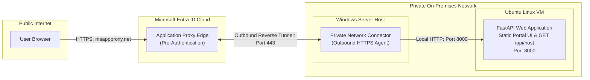
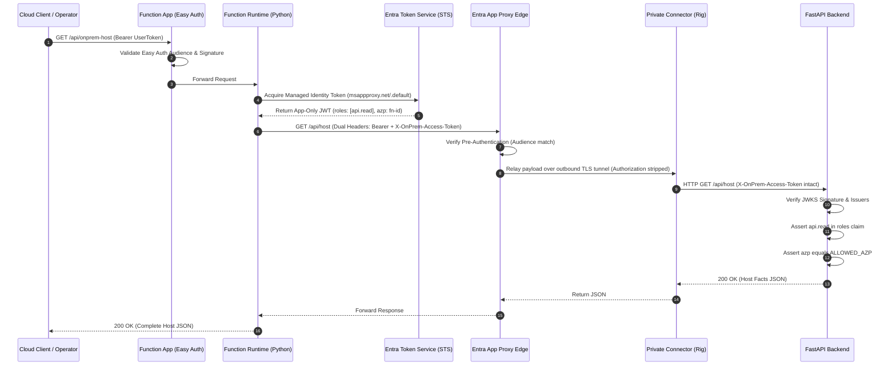

# Beyond the Network Boundary: Modernizing Legacy APIs with Entra Application Proxy and Conditional Access

Enterprise architectures still harbour legacy web applications trapped inside private data centers and on-premises virtual networks. For decades, infrastructure teams treated the corporate firewall as an impenetrable shield. If a packet originated from inside the private subnet, it was trusted by default. That paradigm is dead. Relying on network location for security creates a fragile perimeter where a single compromised host exposes every internal service to lateral traversal. True zero trust demands discarding implicit network trust entirely. Identity is the only boundary that matters. In this project, I took an on-premises FastAPI application running on an Ubuntu host and exposed it securely to the cloud without opening a single inbound firewall port, without configuring cumbersome VPN concentrators, and without leaving internal APIs open to unauthenticated network traffic.

## Establishing the Zero-Trust Bridge

Connecting private infrastructure to public cloud services traditionally required establishing site-to-site IPsec tunnels, express routes, or publishing internal endpoints through perimeter reverse proxies with static NAT rules. Both patterns widen the attack surface by exposing public listening ports to port scanners and distributed denial of service attacks. Microsoft Entra Application Proxy flips this connectivity model on its head through lightweight Private Network Connectors.

The connector is a stateless software agent installed inside the private environment. Instead of listening for inbound connections from the internet, the connector initiates secure, outbound-only HTTPS connections over port 443 to the Microsoft Entra cloud service. When an external request arrives at the Entra Application Proxy edge, Entra holds the connection, evaluates identity policies, and relays the request down the existing outbound control channel to the connector. The connector then dispatches the HTTP request to the internal web server over the local area network.


In my lab configuration, I published the internal endpoint `http://on-prem-webapp:8000/` through Microsoft Entra Application Proxy to an external address hosted on `msappproxy.net`. The target FastAPI application is deliberately designed with both a static website frontend at its root and a JSON API endpoint at `/api/host`. This split is important because it demonstrates that Application Proxy is not solely an API gateway or modernization bridge for headless services. It functions equally well as a modern identity wrapper for legacy web portals, internal administrative tools, and browser-driven intranets that were originally built without any concept of federated single sign-on.

Deploying this architecture also surfaced a fundamental infrastructure constraint that every systems engineer must plan for. My Python web application was hosted on an Ubuntu Linux virtual machine, but the Microsoft Entra Private Network Connector can only be installed on Windows Server. There is no native Linux package, systemd daemon, or official containerized release of the connector software. To bridge this divide, I provisioned a dedicated Windows host on the same private virtual network, installed the connector service, and verified line-of-sight routing over local HTTP port 8000 to the Linux server. The Windows machine maintains the encrypted outbound pipe to Microsoft Entra ID, while the Linux machine runs the application runtime completely unencumbered by identity agent software.

The critical architectural setting on the application registration was configuring Pre-Authentication to `Microsoft Entra ID`. Selecting Passthrough would have turned Application Proxy into a blind reverse proxy, forwarding unauthenticated internet packets straight into the private network. By choosing Entra ID pre-authentication, no anonymous request can ever reach the on-premises connector or the internal network. Traffic is halted, inspected, and authenticated at Microsoft's global edge before the connector ever receives a signal.


Inspecting the Private Network connectors blade in the Microsoft Entra admin center verified that my on-premises connector, named Rig, was registered and reporting an active health status within its default connector group. With the outbound reverse proxy tunnel established, internet clients could resolve the public proxy URL, authenticate against Microsoft Entra ID, and view the internal service.



## The Naive Access Trap and The Vanishing Bearer Token

With the proxy tunnel operational, navigating to the external URL in a browser presented my static dashboard. Clicking the interactive control dispatched a GET request to `/api/host`, returning system facts about the underlying Ubuntu kernel, Python runtime, and host environment.


It was tempting to declare victory right here. The application was published, inbound ports remained closed, and users had to sign in to Entra ID before seeing the page. But stopping here is a common and dangerous trap. Returning host metadata in this lab is simply a clean, tangible demonstration of technology. In an enterprise production deployment, that backend route could easily be serving confidential payroll figures, sensitive employee records, or proprietary financial ledgers. Entra Application Proxy pre-authentication secures the public browser front door, but it provides zero protection to the internal service once traffic sits inside the perimeter. If an adversary gained a foothold on another server or workstation within the private subnet, they could query `http://on-prem-webapp:8000/api/host` directly across the local network and siphon critical business data without presenting a single credential or leaving an identity audit trail.

Furthermore, I wanted to allow automated cloud workloads like Azure Functions to query the API programmatically. When I began testing workload access, I collided with an undocumented operational reality of Entra Application Proxy: pre-authentication intercepts and strips the standard `Authorization: Bearer` header before forwarding requests down the connector tunnel.

Because App Proxy manages user single sign-on and downstream Kerberos constrained delegation, it treats the incoming `Authorization` header as its own transport envelope. If an automated API client sends an OAuth access token in the `Authorization` header meant for the backend API, Application Proxy consumes that header at the edge. The on-premises connector forwards the payload to the backend completely naked.

To defend the backend API against unauthorized local network traffic while accommodating App Proxy header stripping, I engineered a dual-header extraction strategy inside the FastAPI security layer. The backend inspects the standard `Authorization` header first, but immediately falls back to a custom header named `X-OnPrem-Access-Token`.

```python
def extract_access_token(
    request: Request,
    credentials: HTTPAuthorizationCredentials | None,
    settings: Settings,
) -> str | None:
    if credentials is not None and credentials.scheme.lower() == "bearer":
        return credentials.credentials
    authorization = request.headers.get("Authorization")
    if authorization and authorization.lower().startswith("bearer "):
        return authorization.split(" ", 1)[1].strip()
    custom = request.headers.get(settings.access_token_header)
    if custom:
        return custom.strip()
    return None
```

Once this dependency was attached to my API routes, the security posture shifted dramatically. Loading the static website through App Proxy still succeeded because the web shell is an unauthenticated presentation tier, but the background fetch to `/api/host` was instantly rejected with an HTTP 401 Unauthorized error. The API was no longer relying on perimeter proximity; it was actively demanding cryptographically signed proof of identity.


## Cloud-Native Ingestion: Azure Functions, Easy Auth, and Managed Identities

Modern hybrid architectures do not exist solely for human users in web browsers. They exist to feed data into distributed cloud pipelines. To model this, I provisioned an Azure Function on the serverless Flex Consumption tier using Python 3.14, designed to act as an automated ingestion proxy.

The Function App implements a double-sided identity pattern. On the inbound side, it is protected by Microsoft Entra Easy Auth, requiring incoming client calls to present a valid user token. On the outbound side, the Function does not store any secrets, API keys, or certificates. Instead, it leverages an Azure System-Assigned Managed Identity to acquire tokens on the fly from the Azure Instance Metadata Service.

```python
@app.route(route="onprem-host", methods=["GET"])
def onprem_host(req: func.HttpRequest) -> func.HttpResponse:
    scope = os.environ.get("ON_PREM_API_SCOPE")
    target = os.environ.get("ON_PREM_HOST_URL")
    try:
        credential = DefaultAzureCredential()
        token = credential.get_token(scope).token
    except Exception as exc:
        return func.HttpResponse(
            body=json.dumps({"error": "token_acquisition_failed", "reason": str(exc)}),
            status_code=401,
            mimetype="application/json",
        )

    response = httpx.get(
        target,
        headers={
            "Authorization": f"Bearer {token}",
            ON_PREM_ACCESS_TOKEN_HEADER: token,
        },
        timeout=30.0,
        follow_redirects=True,
    )
    return func.HttpResponse(
        body=response.content,
        status_code=response.status_code,
        mimetype="application/json",
    )
```

Integrating this relay revealed two classic token validation gotchas during command-line testing. When calling the Function endpoint via curl, passing an Azure Resource Manager token minted for `https://management.core.windows.net/` triggered an immediate `IDX10214: Audience validation failed` error from Easy Auth. The client must explicitly request a token scoped to the Easy Auth application registration using the exposed scope `api://<easyauth-app-id>/access_as_user`. Moments later, piping the output of the Azure CLI token query directly into curl without extracting the raw string value triggered `IDX12741: JWT is not well formed`, reminding me that Easy Auth expects a raw, three-part base64 encoded JWT rather than a JSON response envelope.

The second identity trap involved the outbound scope for the Managed Identity. In modern Entra v2 application registrations, developers routinely request tokens using the format `api://<client-id>/.default`. However, when Entra issues an app-only token for that scope, the `aud` claim in the resulting JWT is set to the raw client GUID. When that token hit Entra Application Proxy pre-authentication, the proxy rejected it. App Proxy requires the token audience to match the exact external Application ID URI registered on the proxy application, which is the public URL `https://projectfastapi-benrobertsio.msappproxy.net/.default`. Aligning the Function environment variable with the URL-based Application ID URI resolved the pre-authentication check.


Executing the curl command against the Azure Function confirmed the complete end-to-end chain. Easy Auth validated the inbound user token, the Function acquired an outbound Managed Identity token, transmitted it across both the `Authorization` and `X-OnPrem-Access-Token` headers to satisfy App Proxy, traversed the reverse tunnel, and returned the Ubuntu host facts.


## Enforcing Claims and Bounding Workload Identity

Validating an access token requires far more than checking whether the signature was stamped by Microsoft. In a zero-trust architecture, the backend must verify that the principal presenting the token is explicitly authorized to execute the requested operation.

Inside `on-prem-app/src/auth.py`, token decoding is backed by PyJWT and a cached JSON Web Key Set (JWKS) client that queries `login.microsoftonline.com`. The service validates the cryptographic signature, checks the expiration timestamp, confirms that the tenant matches my organization, and ensures the audience matches the Application ID URI.

```python
def validate_tenant_token(token: str, settings: Settings) -> dict[str, Any]:
    if not settings.tenant_id or not settings.api_audience:
        raise HTTPException(
            status_code=status.HTTP_500_INTERNAL_SERVER_ERROR,
            detail="Auth is enabled but TENANT_ID and/or API_AUDIENCE are not configured.",
        )

    signing_key = _jwks_client(settings.tenant_id).get_signing_key_from_jwt(token)
    claims = jwt.decode(
        token,
        signing_key.key,
        algorithms=["RS256"],
        audience=settings.api_audience,
        issuer=_accepted_issuers(settings.tenant_id),
        options={"require": ["exp", "iss", "aud"]},
    )
    return claims
```

Once the claims dictionary is unpacked, I enforce two discrete authorization boundaries. First, the token must contain the `api.read` application role. Second, to prevent any arbitrary service in the tenant that might obtain this role from calling the endpoint, I inspect the authorized party claim (`azp` in v2 tokens, or `appid` in v1 tokens). The helper function `require_allowed_azp` compares the caller ID against an allowlist configured in the environment:

```python
def require_allowed_azp(claims: dict[str, Any], settings: Settings) -> None:
    if not settings.allowed_azp:
        raise HTTPException(
            status_code=status.HTTP_500_INTERNAL_SERVER_ERROR,
            detail="Auth is enabled but ALLOWED_AZP is not configured.",
        )

    party = _authorized_party(claims)
    if party != settings.allowed_azp:
        raise HTTPException(
            status_code=status.HTTP_403_FORBIDDEN,
            detail=f"Calling application '{party}' is not authorized.",
        )
```

This dual-tier validation creates a clean separation between human and machine access. Human users authenticate interactively through browser sessions governed by Conditional Access, while cloud daemons authenticate headlessly via Managed Identities carrying explicit roles and verified client identities.



## Declarative Governance: Conditional Access Policy as Code via UTCM

With data paths and API authorization locked down, I turned my focus to the human access path. When employees connect to the internal web dashboard through Application Proxy, organization policy mandates strict identity verification. I designed the Conditional Access Policy to target the App Proxy enterprise application, require Multi-Factor Authentication, and enforce a time-based sign-in frequency to curb stale session tokens.

```json
{
  "displayName": "CA-Lab-AppProxy-RequireMFA",
  "state": "enabledForReportingButNotEnforced",
  "conditions": {
    "clientAppTypes": ["all"],
    "applications": {
      "includeApplications": ["8f99f135-63dd-4679-88b7-32ad6ebf4219"]
    },
    "users": {
      "includeUsers": ["All"]
    }
  },
  "grantControls": {
    "operator": "OR",
    "builtInControls": ["mfa"]
  },
  "sessionControls": {
    "signInFrequency": {
      "isEnabled": true,
      "type": "hours",
      "value": 1,
      "frequencyInterval": "timeBased"
    }
  }
}
```

An architectural question immediately arose: why does enforcing MFA on the Application Proxy app not break the automated Azure Function? The answer lies in how Entra Conditional Access classifies principals. Standard Conditional Access policies evaluate human user sign-in flows and delegated permissions. Managed identities run as machine workloads using the OAuth client credentials flow. Because the Azure Function acquires app-only tokens directly from the token service without interactive user context, user-targeted Conditional Access policies do not intercept its calls.

This naturally leads to a deeper question: why not apply Microsoft Entra Workload Identity Protection and risk-based Conditional Access directly to the managed identity? Microsoft Learn documentation on workload identities makes the platform boundaries explicit. While Entra Workload ID Premium extends Conditional Access and ID Protection to single-tenant service principals registered in the tenant, managed identities and Microsoft applications are entirely excluded from policy coverage. The rationale comes down to architecture and credential ownership. Workload Identity Protection is built to detect compromised static credentials, leaked application secrets, rogue certificate additions, and anomalous IP hops for service principals. Managed identities do not possess application objects, only local service principal representations, and they never expose static credentials. Azure manages their underlying certificates automatically through the local Instance Metadata Service on trusted infrastructure, rotating keys every forty-five days. Because there are no user-managed secrets to leak and token acquisition happens over isolated platform channels, Entra ID Protection and workload Conditional Access do not evaluate them. Workload governance cannot be outsourced to an Entra policy engine; it must be enforced explicitly through least-privilege application role assignments and strict in-code caller assertions like my ALLOWED_AZP verification.


Configuring Conditional Access by clicking through the Azure portal creates an unmanageable governance risk. Manual configurations invite human error, lack auditable source control, and inevitably succumb to configuration drift. To eliminate this weakness, I turned to Microsoft Entra Unified Tenant Configuration Management (UTCM).

UTCM is Microsoft's cloud-native framework for declarative tenant configuration. Instead of running imperative scripts that overwrite settings blindly, UTCM lets administrators declare a configuration baseline as a JSON artifact under `microsoft.entra.conditionalAccessPolicy` and register a background configuration monitor. Every six hours, the UTCM engine evaluates the tenant state against the baseline and flags any unauthorized changes as configuration drift.

Automating this deployment surfaced several sharp technical lessons. First, attempting to deploy the UTCM baseline using the standard Azure CLI failed with an `AADSTS65002` error. The UTCM configuration monitoring scopes (`ConfigurationMonitoring.ReadWrite.All`) are first-party pre-authorized permissions that the generic Azure CLI client registration is forbidden from requesting. I had to migrate the deployment automation entirely to Microsoft Graph PowerShell using `Connect-MgGraph`.

Second, I discovered that Microsoft Graph has rigid validation rules regarding session lifetimes. I originally sought to set sign-in frequency to thirty minutes to mimic aggressive session expiry. Graph rejected the payload immediately with a 400 Bad Request error. The `signInFrequency` session control does not support minutes; it only accepts integer values denominated in `hours` or `days`. One hour is the absolute platform floor for time-based session controls.

Third, I wrestled with PowerShell's aggressive collection unrolling behavior. When constructing JSON payloads with PowerShell hashtables, returning a single-element list like `@('all')` causes PowerShell to unroll the collection into a bare string scalar `"all"`. Graph CA schema validation requires `clientAppTypes`, `includeUsers`, and `builtInControls` to be explicit JSON arrays. Serializing bare strings resulted in obscure `1007: Incoming ConditionalAccessPolicy object does not match schema` errors. I resolved this by explicitly building .NET generic collections and suppressing pipeline unrolling with the comma operator.

Finally, the UTCM service validator enforces strict character limits on monitor names. Attempting to name my monitor `UTCM-Lab-AppProxy-RequireMFA` failed because the API validator threw an exception declaring that display names may only contain alphabets, numbers, and spaces. Replacing hyphens with spaces allowed the resource to pass validation cleanly.

```powershell
function ConvertTo-UtcmDisplayName {
    param([Parameter(Mandatory)][string]$Name)
    $cleaned = [regex]::Replace($Name, '[^A-Za-z0-9 ]+', ' ')
    $cleaned = [regex]::Replace($cleaned, '\s+', ' ').Trim()
    return $cleaned
}

$monitorId = Set-UtcmMonitor -Baseline $baseline -MonitorName $MonitorDisplayName
```

Running `Deploy-UtcmCaAppProxyMfa.ps1` completed the loop: asserting service principal app role assignments for `Policy.Read.All` and `Policy.Read.ConditionalAccess`, creating or updating the Conditional Access policy via Microsoft Graph, and registering the UTCM configuration monitor for ongoing drift analysis.


## What True Modernization Looks Like

Modernizing an on-premises legacy application is rarely about rewriting code from scratch. Many business-critical applications cannot simply be refactored into microservices or re-platformed into containers overnight. But leaving them hidden behind legacy network firewalls is no longer an acceptable security posture.

True modernization is about establishing identity as the primary control plane. By combining Microsoft Entra Application Proxy with Private Network Connectors, I eliminated inbound internet attack vectors without altering physical network topologies. By implementing a dual-header parsing strategy in FastAPI, I defended the internal API against lateral network traversal while respecting proxy transport semantics. By wiring Azure Functions through Easy Auth and Managed Identities, I enabled keyless cloud automation. And by expressing Conditional Access policies as code through Entra UTCM, I ensured that security policies remain auditable, repeatable, and resilient against configuration drift.

When identity becomes the perimeter, physical location ceases to matter. The private network is treated as untrusted, every request is cryptographically proven, and the entire architecture operates under the uncompromising discipline of zero trust.

## References

1. [Microsoft Entra application proxy](https://learn.microsoft.com/entra/identity/app-proxy/overview-what-is-app-proxy)
2. [Microsoft Entra private network connectors](https://learn.microsoft.com/entra/global-secure-access/concept-connectors)
3. [What is Conditional Access?](https://learn.microsoft.com/entra/identity/conditional-access/overview)
4. [Configure authentication session management with Conditional Access](https://learn.microsoft.com/entra/identity/conditional-access/howto-conditional-access-session-lifetime)
5. [Conditional Access for workload identities](https://learn.microsoft.com/entra/identity/conditional-access/workload-identity)
6. [Securing workload identities with Microsoft Entra ID Protection](https://learn.microsoft.com/entra/id-protection/concept-workload-identity-risk)
7. [What are managed identities for Azure resources?](https://learn.microsoft.com/entra/identity/managed-identities-azure-resources/overview)
8. [Authentication and authorization in Azure App Service and Azure Functions](https://learn.microsoft.com/azure/app-service/overview-authentication-authorization)
9. [Use managed identities for App Service and Azure Functions](https://learn.microsoft.com/azure/app-service/overview-managed-identity)
10. [Configuration management in Microsoft Entra Tenant Governance](https://learn.microsoft.com/entra/id-governance/tenant-governance/configuration-management)
11. [Microsoft Azure Python SDK](https://learn.microsoft.com/en-us/azure/developer/python/sdk/azure-sdk-overview?view=azure-python)
12. [Azure Functions developer reference guide for Python apps](https://learn.microsoft.com/en-us/azure/azure-functions/functions-reference-python?pivots=python-mode-decorators)