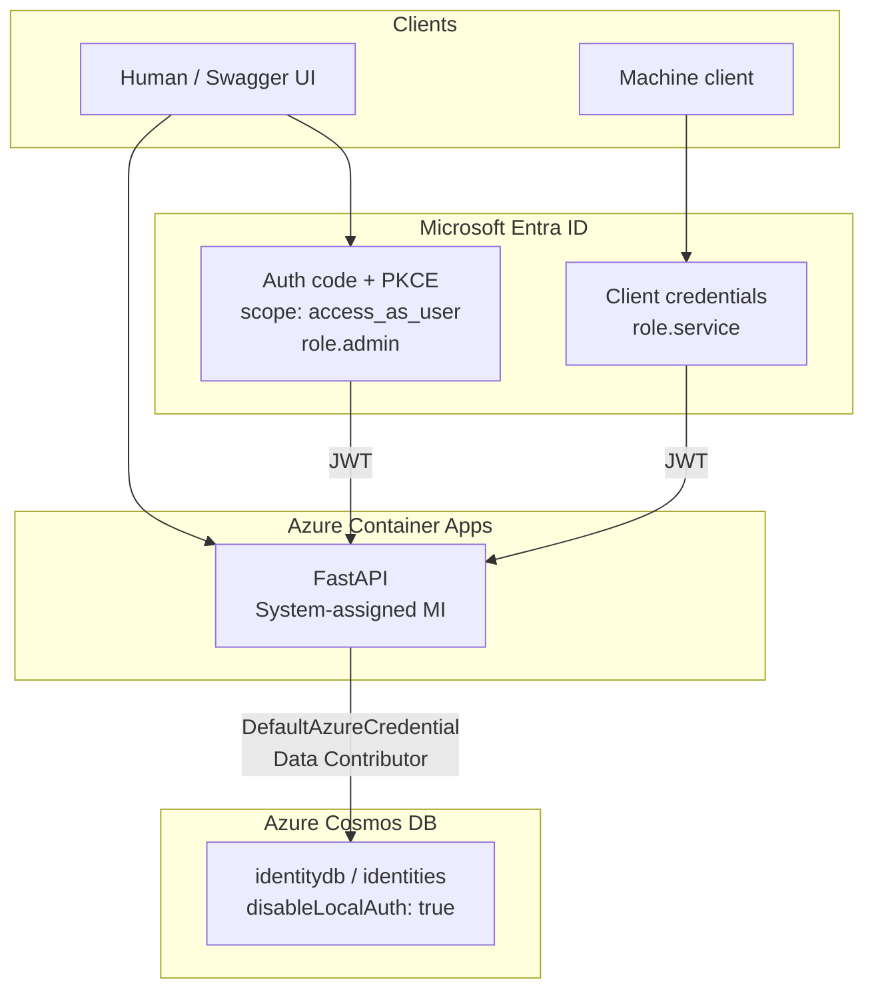
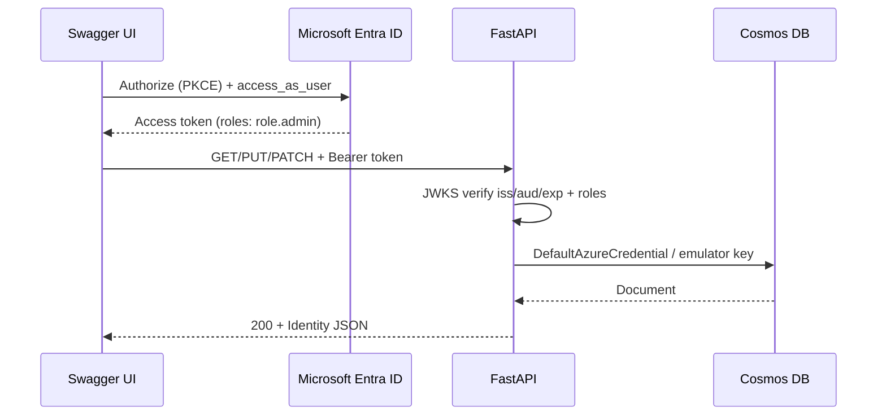
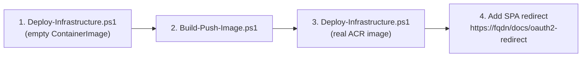

# FastAPI Swagger Auth Roles

Python FastAPI identity API on Azure Container Apps with Microsoft Entra app-role authorization, Swagger browser sign-in (OAuth2 + PKCE), and keyless Cosmos DB access via system-assigned managed identity.

| Area | Choice |
|------|--------|
| Runtime | Python 3.14, FastAPI, Uvicorn |
| Auth | Microsoft Entra ID — JWT validation + app roles |
| Data | Azure Cosmos DB (SQL API); local Cosmos emulator |
| Hosting | Azure Container Apps |
| IaC / deploy | Bicep + PowerShell (`script/`) |
| Packaging | Dockerfile; `az acr build` |

## Contents

* [Architecture](#architecture)
* [Auth model](#auth-model)
* [API](#api)
* [Repository layout](#repository-layout)
* [Prerequisites](#prerequisites)
* [Entra app registration](#entra-app-registration)
* [Local development](#local-development)
* [Deploy to Azure](#deploy-to-azure)
* [Configuration](#configuration)
* [Troubleshooting](#troubleshooting)

## Architecture



| Component | Purpose |
|-----------|---------|
| Azure Container Registry | Stores the API image; admin user disabled |
| Container Apps Environment | Hosts the Container App |
| Container App | Runs the API; system-assigned managed identity |
| Cosmos DB (serverless) | Persistence; local auth disabled |
| Log Analytics | Container Apps environment logs |

**Local vs Azure data plane**

| Mode | Credential | Notes |
|------|------------|-------|
| Local (`USE_COSMOS_EMULATOR=true`) | Well-known emulator master key | TLS verify and endpoint discovery disabled |
| Azure | `DefaultAzureCredential` (managed identity) | No Cosmos keys; RBAC data contributor |

## Auth model

Single Entra app registration (`project-fastapi-swagger`) is both the API resource and the Swagger SPA client.

| Role | `allowedMemberTypes` | Caller |
|------|----------------------|--------|
| `role.admin` | User | Human Swagger / interactive |
| `role.service` | Application | Machine / client credentials |

| Surface | Value |
|---------|-------|
| Application ID URI | `api://{appId}` |
| Delegated scope | `access_as_user` |
| Token version | `api.requestedAccessTokenVersion` = `2` |
| Local SPA redirect | `http://localhost:8000/docs/oauth2-redirect` |
| Cloud SPA redirect | `https://<apiFqdn>/docs/oauth2-redirect` |

Authorization on identity routes requires `role.admin` **or** `role.service` in the JWT `roles` claim. Scope `access_as_user` is used to obtain a user access token; privilege is decided by roles.



## API

| Method | Path | Auth | Description |
|--------|------|------|-------------|
| `GET` | `/health` | None | Liveness |
| `GET` | `/identities/{id}` | Bearer + role | Read identity |
| `PUT` | `/identities/{id}` | Bearer + role | Upsert (path `id` must match body `id`) |
| `PATCH` | `/identities/{id}` | Bearer + role | Partial update (`displayName`) |
| `GET` | `/docs` | Entra via Authorize | Swagger UI |

**Document shape**

```json
{
  "id": "test1",
  "displayName": "Example"
}
```

Cosmos partition key: `/id`.

## Repository layout

```text
project-fastapi-swagger-auth-roles/
├── api/main.py                 # FastAPI entry + Swagger OAuth init
├── src/
│   ├── auth.py                 # JWT / JWKS / role checks
│   ├── config.py               # Settings from environment
│   ├── cosmos/                 # Cosmos client + identity store
│   ├── models/identity.py      # Pydantic models
│   └── routes/identities.py    # HTTP routes
├── infra/main.bicep            # ACR, ACA, Cosmos, RBAC
├── script/
│   ├── Deploy-Infrastructure.ps1
│   └── Build-Push-Image.ps1
├── docker-compose.yml          # Cosmos emulator only
├── Dockerfile
├── requirements.txt
├── pyproject.toml
└── .env.example
```

## Prerequisites

* Python 3.14+
* Docker (Cosmos emulator / optional local image builds)
* Azure CLI (`az`) and Az PowerShell module
* Microsoft Entra permissions to create an app registration and assign app roles
* Azure subscription with rights to deploy ACR, Container Apps, Cosmos DB, and role assignments

## Entra app registration

Create one app registration (example display name: `project-fastapi-swagger`):

| Step | Blade | Configuration |
|------|-------|---------------|
| Register | App registrations | Single-tenant (or as required) |
| Expose API | Expose an API | Application ID URI `api://{appId}` |
| Scope | Expose an API | `access_as_user` (Admins and users) |
| Preauthorize | Authorized client applications | This app’s client ID → `access_as_user` |
| Roles | App roles | `role.admin` (Users/Groups); `role.service` (Applications) |
| Token version | Manifest | `api.requestedAccessTokenVersion` = `2` |
| Auth | Authentication → SPA | `http://localhost:8000/docs/oauth2-redirect` (add cloud FQDN after deploy) |
| Assign | Enterprise application | Assign your user `role.admin` |

Record **Directory (tenant) ID** and **Application (client) ID** for `.env` and deploy scripts.

## Local development

### 1. Cosmos emulator

```powershell
docker compose up -d
```

Emulator endpoint: `https://localhost:8081/` (well-known master key; see `.env.example`).

### 2. Python env

```powershell
cd project-fastapi-swagger-auth-roles
python -m venv .venv
.\.venv\Scripts\Activate.ps1
pip install -r requirements.txt
copy .env.example .env
```

Fill `.env`:

```env
COSMOS_ENDPOINT=https://localhost:8081/
USE_COSMOS_EMULATOR=true
TENANT_ID=<directory-id>
API_CLIENT_ID=<application-client-id>
OPENAPI_CLIENT_ID=<application-client-id>
```

### 3. Run API

```powershell
uvicorn api.main:app --reload --host localhost --port 8000
```

Open `http://localhost:8000/docs` (use **localhost**, not `127.0.0.1`, for Entra SPA redirects).

1. Click **Authorize** (leave client secret blank; PKCE).
2. Sign in; ensure scope `api://{appId}/access_as_user` is selected.
3. `PUT /identities/test1` with `{"id":"test1","displayName":"Example"}`.
4. `GET /identities/test1`.

## Deploy to Azure

Deploy is a three-pass flow: bootstrap infra with a public hello-world image, build/push the API image to ACR, redeploy with that image.



### Prerequisites

```powershell
Connect-AzAccount
az login   # required for az acr build
```

### Pass 1 — Bootstrap (hello-world)

```powershell
.\script\Deploy-Infrastructure.ps1 `
  -ResourceGroup <rg-name> `
  -TenantId <directory-id> `
  -ApiClientId <application-client-id>
```

Optional parameters:

| Parameter | Default | Description |
|-----------|---------|-------------|
| `-Location` | `australiaeast` | Resource group location |
| `-BaseName` | `fsa` | Short name prefix (keep Container App name ≤ 32 chars) |
| `-Environment` | `dev` | `dev` / `test` / `prod` |
| `-AcrName` | *(generated)* | Override ACR name |
| `-ContainerImage` | *(empty)* | Empty → MCR hello-world |
| `-OpenApiClientId` | same as ApiClientId | Swagger OAuth client |
| `-CosmosDatabaseName` | `identitydb` | Cosmos database id |
| `-CosmosContainerName` | `identities` | Cosmos container id |

Note the deployment outputs: `acrName`, `acrLoginServer`, `apiFqdn`.

### Pass 2 — Build and push image

```powershell
.\script\Build-Push-Image.ps1 -AcrName <acrNameFromOutputs>
```

Default tag: `fastapi-swagger:dev` → `<loginServer>/fastapi-swagger:dev`.

### Pass 3 — Deploy real image

```powershell
.\script\Deploy-Infrastructure.ps1 `
  -ResourceGroup <rg-name> `
  -TenantId <directory-id> `
  -ApiClientId <application-client-id> `
  -ContainerImage <loginServer>/fastapi-swagger:dev
```

### Pass 4 — Entra SPA redirect

In the Entra app → **Authentication** → SPA, add:

```text
https://<apiFqdn>/docs/oauth2-redirect
```

Open `https://<apiFqdn>/docs`, Authorize, and exercise GET/PUT/PATCH.

## Configuration

| Variable | Local | Azure (Bicep env) |
|----------|-------|-------------------|
| `COSMOS_ENDPOINT` | Emulator URL | Cosmos account endpoint |
| `COSMOS_KEY` | Emulator key (optional; default well-known) | Not set |
| `COSMOS_DATABASE` | `identitydb` | `identitydb` |
| `COSMOS_CONTAINER` | `identities` | `identities` |
| `USE_COSMOS_EMULATOR` | `true` | `false` |
| `TENANT_ID` | Required | Required |
| `API_CLIENT_ID` | Required (audience) | Required |
| `OPENAPI_CLIENT_ID` | Usually same as API client | Usually same as API client |

## Troubleshooting

| Symptom | Likely cause | Action |
|---------|--------------|--------|
| Entra redirect fails with `127.0.0.1` | SPA redirect must be `http://localhost` or `https://` | Use localhost; update Entra SPA URI |
| Swagger shows Authorized but API returns 401 | v1 access token (`iss` = `sts.windows.net`) | Set `api.requestedAccessTokenVersion` = `2`; re-Authorize |
| 403 on identity routes | Missing app role in token | Assign `role.admin` (user) or `role.service` (app) |
| GET 500 after PUT 200 | Pydantic rejecting Cosmos `_rid` / `_etag` | Model uses `extra="ignore"` (already in repo) |
| Container App name invalid / `--` | Name length > 32 after truncation | Keep `-BaseName` short (default `fsa`) |
| Cosmos create timeout / Not available | Regional control-plane failure | Delete stuck account; redeploy |

## Related

Narrative write-up of how this project was built with [VibeWise Learn](https://github.com/broberts23/vibe-wise): see [blog.md](blog.md).
