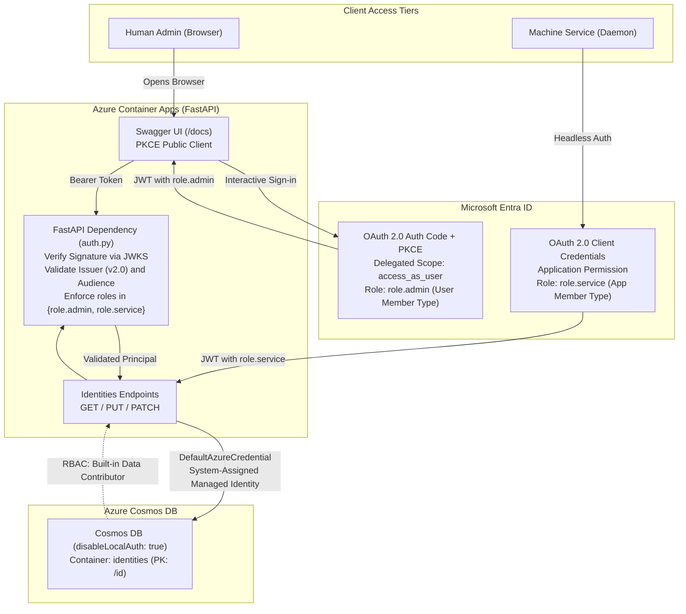

# The Architecture You Can Actually Explain

Writing individual lines of code is no longer the bottleneck in software engineering. Any modern language model can emit hundreds of lines of syntactically valid FastAPI before your coffee finishes brewing. The failure mode of our current landscape has shifted entirely: generation is instant, but comprehension is slipping away. When an agent constructs a distributed system unattended, the human engineer often inherits a pile of working code they cannot defend in a code review or debug when tokens fail in production. Real engineering has always lived in the seams between systems: trust boundaries, token lifecycles, role assignments, and infrastructure topologies. If you cannot explain why a token was rejected or how a managed identity talks to a database without keys, the speed of generation is a trap. I built [VibeWise](https://github.com/broberts23/vibe-wise) to break that pattern. It is a Cursor optimised version of [nykooi1's vibe-wise project](https://github.com/nykooi1/vibe-wise) that I forked and enhanced with Microsoft MCP support. It is a skill that turns the agent into an interactive pair programmer that refuses to make architectural decisions on your behalf. To prove the dynamic, I ran it against a deceptively nuanced build: a FastAPI service backed by Azure Cosmos DB, secured with Microsoft Entra app roles, and deployed to Azure Container Apps using Bicep.

## How Learn Mode Flips the Dynamic

Standard agent workflows reward passivity. You type a prompt, watch code scroll by, and hope the model chose sane defaults. VibeWise Learn mode operates under an opposite protocol: the human designs the system, and the agent writes the implementation only after you reason through the tradeoffs. The skill is specifically tuned for Azure, Microsoft Entra ID, Bicep infrastructure, and Python automation via official Microsoft SDKs.

The interaction flows through three explicit gates. A Build checkpoint presents an open question about how you intend to solve a problem. It never supplies a hidden architectural blueprint disguised as advice. A Design checkpoint evaluates your chosen approach, records the decision, and surfaces any architectural tensions. If you agree, you confirm the design, but no code is written yet. An Implementation checkpoint is the only gate that authorizes code generation. It lists the exact files and modifications scheduled for disk, and it requires explicit approval before anything changes. Alongside every gate sits a discussion option, ensuring you can halt the momentum and dissect unfamiliar concepts before committing.

When the conversation touches Microsoft platform specifics, the skill does not rely on training weights that might hallucinate deprecated APIs. It queries the Microsoft Learn Model Context Protocol (MCP) server using tools like docs search and code sample search. The agent reads the authoritative documentation before explaining a concept, grounding every identity and infrastructure decision in official Microsoft specifications.

The experience adapts to your background without taking away control. I approached this project as a beginner in Python and FastAPI, an intermediate practitioner in Azure Container Apps and Cosmos DB, and an expert in Entra ID, Bicep, and PowerShell. The skill adjusted its technical depth accordingly, providing fundamental Python scaffolding while treating the identity and cloud architecture with the rigor expected of a production system.

## Setup and State Management

Getting the skill into Cursor requires a single command using the skills package runner:

```sh
npx skills add broberts23/vibe-wise
```

Once installed into your project or user skills directory, you initiate learning mode inside the Cursor Agent chat:

```text
/vibe-wise-learn
```

On an initial run, the skill conducts a concise onboarding session in the terminal chat, asking for your project type, stack familiarity, and baseline preferences. It records everything in a dedicated local directory named `.vibe-wise` at your git root. This directory contains three simple Markdown files: `profile.md` for learner experience levels, `project-map.md` for architectural components and trust boundaries, and `progress.md` for tracking demonstrated concepts and open decisions. There is no cloud telemetry and no background database.

If you run skills-only mode, you can connect the Microsoft Learn MCP server directly in your Cursor settings or project configuration:

```json
{
  "mcpServers": {
    "microsoft-learn": {
      "url": "https://learn.microsoft.com/api/mcp"
    }
  }
}
```

Every new session started with `/vibe-wise-learn` inspects `.vibe-wise` to restore context. It reads pending decisions, recalls which concepts you have already mastered, and picks up precisely where your architecture left off.

## Requirements Are Not a Design

Our target application had a clear list of business requirements. We needed a FastAPI backend exposing GET, PUT, and PATCH operations against a Cosmos DB document store. We wanted to enforce strict Microsoft Entra authentication, creating a distinction between interactive human users exploring Swagger documentation and non-interactive daemon services issuing direct API calls. All cloud communication had to rely on keyless Azure Role-Based Access Control, strictly banning shared keys and connection strings. Finally, the development workflow demanded local verification against the Cosmos DB emulator before deploying to Azure via Bicep and PowerShell.


Listing requirements does not equal designing an application. When I handed this scope to the agent, it halted at the first Build checkpoint and demanded an implementation sequence.

```text
build FastAPI application first, create entra app reg, expose api, create claims.
then dockerfile/compose, docker build and debug locally using azure cosmos emulator
using well-known master key
```

Rather than jumping into writing boilerplates, the agent reflected my plan back to me with a critical architectural observation. Entra app roles and browser-based Swagger authentication only deliver value once the FastAPI application implements token validation. If we build the application first, we must decide whether the initial endpoints are completely unprotected or if they contain placeholder authentication hooks.


I chose to defer authentication until after the Entra application registration was defined, focusing our initial slice on the data path. When the agent asked how to structure the repository, I provided the file layout:

```text
/api and main.py for the api, /src for the modules. /infra for the bicep and /script
for the powershell. the document contract isn't the focus, basic idenity mockup is fine.
```


The resulting Design checkpoint confirmed a lightweight identity model consisting of an identifier and a display name, stored in a Cosmos container partitioned on `/id`.


Only after I confirmed the implementation checkpoint did the agent write the initial files: `api/main.py`, the routing logic in `src/routes/identities.py`, and the emulator-aware Cosmos store in `src/cosmos/identities.py`.


The database client factory illustrates how the codebase accommodates local developer iteration without compromising cloud security posture. When running locally against the emulator, the client bypasses certificate verification and ignores endpoint discovery because the Docker container advertises internal network addresses. When deployed to Azure, the identical factory initializes `DefaultAzureCredential` against the managed identity without any connection strings in sight.

```python
def create_cosmos_client(settings: Settings) -> CosmosClient:
    if settings.use_cosmos_emulator:
        return CosmosClient(
            settings.cosmos_endpoint,
            credential=settings.cosmos_key,
            connection_verify=False,
            enable_endpoint_discovery=False,
        )
    if not settings.cosmos_endpoint:
        raise RuntimeError("COSMOS_ENDPOINT is required when not using the emulator")
    return CosmosClient(
        settings.cosmos_endpoint,
        credential=DefaultAzureCredential(),
    )
```

## The Two-Role Identity Model

With the API skeleton responding locally, we turned to identity architecture. Many teams conflate human administrative access with automated backend pipelines, using single shared credentials or sprawling permission sets. I wanted a rigid separation enforced directly inside the token claims:

```text
one app. two roles. role.admin for human swagger access, role.service for machine
direct api access.
```


The agent stepped in with an explanatory concept callout on Entra application roles and their underlying member types. App roles define an `allowedMemberTypes` attribute. Setting this attribute to `User` creates a role that can be assigned to human identities or security groups in the tenant. Setting it to `Application` allows the role to be granted to client application registrations and managed identities via the OAuth 2.0 client credentials grant.

By mapping `role.admin` to `User` and `role.service` to `Application`, we prevented automated background services from ever requesting or obtaining human documentation rights, while ensuring human administrators cannot run headless automation.



The validation layer inside `src/auth.py` evaluates these roles on every protected request. Rather than scattering security logic across path operations, a dedicated helper inspects the decoded token claims and raises an immediate 403 Forbidden if neither valid role is present.

```python
def require_api_roles(claims: dict[str, Any]) -> dict[str, Any]:
    roles = claims.get("roles") or []
    if isinstance(roles, str):
        roles = [roles]
    if not ALLOWED_API_ROLES.intersection(roles):
        raise HTTPException(
            status_code=status.HTTP_403_FORBIDDEN,
            detail="Token is missing required app role (role.admin or role.service)",
        )
    return claims
```

## Navigating the Entra Scope Dilemma

Configuring an application registration inside the Microsoft Entra admin center often feels like navigating a minefield of overlapping concepts. When we reached this phase, I hit a genuine knowledge gap:


```text
this the part i'm the most unsure about.

i'll create the app in the entra portal. the app name will be "project-fastapi-swagger"
the Application ID URI will the api://{appId}. i don't know what the scopes and
Authorized client applications will be
```

Instead of relying on pre-trained knowledge, the skill invoked the Microsoft Learn MCP server, querying documentation on protected web APIs, delegated permissions, and application roles. It parsed the official guidance and presented a breakdown of scopes versus roles.


Scopes represent delegated permissions, indicating what an application can do on behalf of an interactive, signed-in user. They materialize in access tokens under the `scp` claim. Application roles represent direct privileges assigned to the principal, appearing under the `roles` claim. In our architecture, application roles carry the actual authorization logic. A delegated scope is simply the transport ticket that permits the browser running Swagger UI to obtain a user access token.

I initially attempted a shortcut, proposing to expose the API URI, leave scopes blank, and authorize the client application to bypass consent:

```text
Expose the API under "Expose an API" but leave scoped blank (defer) and populate
the Authorized client applications with the same app’s client ID, bypass the consent prompt at login.
```

The agent caught the technical contradiction immediately. In Microsoft Entra ID, an authorized client application cannot be pre-authorized in a vacuum; it must be bound to a specific delegated scope. Without defining at least one scope, the portal has no mechanism to link the pre-authorized client ID.


Faced with that concrete constraint, I revised the decision:

```text
add one minimal scope now (access_as_user)
```

We settled the design: one application registration named `project-fastapi-swagger`, an Application ID URI of `api://{appId}`, a single delegated scope named `access_as_user`, and the application's own client ID pre-authorized against that scope.


The agent produced an actionable summary table clarifying each portal blade, which removed any lingering ambiguity before I touched the tenant.


## The Localhost Trap and Token Versioning

Next came the browser integration for Swagger UI. The agent laid out the public client authorization flow, recommending the authorization code grant with Proof Key for Code Exchange (PKCE) under a Single-page application platform.


When asked for the local redirect URI, I specified standard loopback syntax:

```text
A. http://127.0.0.1:8000
```


During setup, I caught an Entra security requirement that catches many engineers off guard:

```text
1 but change `http://127.0.0.1:8000/docs/oauth2-redirect` to
`http://localhost:8000/docs/oauth2-redirect`. only "https://url" or
"http://localhost" is supported
```


The Microsoft identity platform enforces strict format checks on SPA redirect URIs. While native applications permit arbitrary IP loopbacks, SPA registrations accept only secure HTTPS endpoints or literal `http://localhost`. Testing with `127.0.0.1` causes instant redirect failures during the OAuth handshake.


Configuring Swagger UI to execute this handshake required wiring FastAPI's OpenAPI metadata with the correct OAuth settings. Setting `usePkceWithAuthorizationCodeGrant` instructs the browser to generate cryptographic challenges on the fly, eliminating the need for client secrets in public browser contexts.

```python
app = FastAPI(
    title="Identity API",
    description="Mock identity API protected by Microsoft Entra app roles.",
    version="0.1.0",
    swagger_ui_init_oauth={
        "clientId": settings.openapi_client_id or settings.api_client_id,
        "appName": "Identity API Swagger",
        "usePkceWithAuthorizationCodeGrant": True,
        "scopes": settings.access_as_user_scope if settings.api_client_id else "",
    },
)
```

On the backend, PyJWT handles token verification by querying Entra's JSON Web Key Set (JWKS) endpoint. The implementation caches signing keys in memory and asserts that the token matches expected audiences and issuers.

```python
def decode_access_token(token: str, settings: Settings) -> dict[str, Any]:
    settings.require_entra()
    signing_key = _get_jwks_client(settings).get_signing_key_from_jwt(token)
    return jwt.decode(
        token,
        signing_key.key,
        algorithms=["RS256"],
        audience=settings.audience_values,
        issuer=settings.issuer,
        options={"require": ["exp", "iss", "aud"]},
    )
```

Once the redirect URI was corrected and the agent implemented the token validation dependency, I clicked the Authorize button in Swagger UI. Entra authenticated my credentials and returned me to Swagger displaying a green authorized badge. Yet the moment I executed a GET request against `/identities/test1`, the API rejected the call with a 401 Unauthorized status.

We temporarily updated the exception handler to expose unverified claims from the inbound token. The resulting diagnostic exposed a classic identity gotcha:

```text
token iss='https://sts.windows.net/7c029110-ec6b-48a2-a1ec-5bdec806f9ce/',
aud='api://8f99f135-63dd-4679-88b7-32ad6ebf4219', ver='1.0';
expected issuer='https://login.microsoftonline.com/7c029110-ec6b-48a2-a1ec-5bdec806f9ce/v2.0'
```

Our FastAPI validation logic was configured to accept modern v2.0 tokens issued by `login.microsoftonline.com`. However, the access token arriving from Entra carried an issuer of `sts.windows.net` and a version of `1.0`.

Many developers assume that calling the Entra v2.0 authorize endpoint (`/oauth2/v2.0/authorize`) guarantees a v2.0 access token. That assumption is incorrect. The client requests the token from the v2 endpoint, but the resource application registration governs the token version emitted by the Security Token Service. Checking the application manifest in the Entra admin center revealed that `api.requestedAccessTokenVersion` was set to `null`, which defaults to legacy v1.0 token formats.


I edited the manifest, set `requestedAccessTokenVersion` to `2`, and re-authenticated in Swagger. The issuer instantly aligned with the v2.0 endpoint, and the PUT endpoint returned an immediate HTTP 200.

A subsequent GET request yielded an unexpected HTTP 500 error. Inspection of the server stack trace revealed that while PUT operations validated data directly against the Pydantic schema, Cosmos DB appends internal system properties (`_rid`, `_self`, `_etag`, `_ts`) during document reads. Our Pydantic model had configured `extra="forbid"`, causing validation crashes on the response path. Updating the model configuration to `extra="ignore"` permanently resolved the issue.

```python
class Identity(BaseModel):
    model_config = ConfigDict(extra="ignore", populate_by_name=True)

    id: str = Field(min_length=1, description="Document id and partition key")
    display_name: str | None = Field(default=None, alias="displayName")
```

With local operations stable, I instructed the agent to strip out the verbose error reporting, locking down the validation module to production-grade security defaults.

## Deploying to Azure Container Apps

The final phase moved our working application into Microsoft Azure. I laid out the orchestration sequence across infrastructure and tooling:

```text
azure resources should be ACR, ACA environment, Cosmos, then SMI role assignments
bicep should accept an input variable for the ACR name and container image,
and pull hello world if blank for first deployment.
subsquent deployment will pull real container image
1 powershell script to deploy bicep
1 powershell script to docker build and push to ACR
1st powershell script again to deploy container
```


This structure solves a common dependency dilemma in cloud deployments. An Azure Container App resource requires a container image to initialize, but you cannot push an image to an Azure Container Registry before that registry exists. By providing a default fallback to Microsoft's public hello-world image, the initial Bicep deployment provisions the Azure Container Registry, Log Analytics, the Container Apps Environment, the Container App with a System-Assigned Managed Identity, and the serverless Cosmos DB account.


Crucially, the template established data-plane RBAC directly through the Cosmos DB provider, assigning the `Cosmos DB Built-in Data Contributor` role (`00000000-0000-0000-0000-000000000002`) to the Container App's managed identity while explicitly setting `disableLocalAuth: true` on the account.

```bicep
resource cosmosDataRole 'Microsoft.DocumentDB/databaseAccounts/sqlRoleAssignments@2024-05-15' = {
  parent: cosmos
  name: guid(cosmos.id, apiApp.id, roleCosmosDataContributor)
  properties: {
    roleDefinitionId: '${cosmos.id}/sqlRoleDefinitions/${roleCosmosDataContributor}'
    principalId: apiApp.identity.principalId
    scope: cosmos.id
  }
}
```

The automation lived in two scripts: `script/Deploy-Infrastructure.ps1` to execute the Bicep template via `New-AzResourceGroupDeployment`, and `script/Build-Push-Image.ps1` to compile and push the application container directly to ACR using `az acr build`.

Cloud environments inevitably introduce real-world operational friction. During our initial run in `australiaeast`, Cosmos DB account creation failed after exceeding control-plane timeouts, leaving the resource trapped in a non-functional provisioning state for over forty minutes. Rather than altering our architecture, the agent identified the error as a platform-level regional failure, noting that the account had to be deleted before any redeployment could succeed.

A second issue emerged from the Container Apps naming engine:

```text
Invalid ContainerApp name 'ca-fastapi-swagger-api-dev-5zlni (trimmed)'. A name must consist of lower case alphanumeric characters or '-', start with an alphabetic character, and end with an alphanumeric character and cannot have '--'. The length must be between 2 and 32 characters inclusive.
```


The error message initially appeared to flag an illegal double hyphen (`--`). In reality, the name was thirty-three characters long, violating Azure's thirty-two character ceiling for Container App identifiers. The ARM validator truncated the string, leaving a trailing hyphen that triggered the syntax failure. Trimming the base naming convention to `fsa` resolved the error completely, allowing the deployment to finish without further friction.


With all resources instantiated in the resource group, inspecting the Container App in the Azure portal confirms that our custom image pulled cleanly from ACR using the system identity.


Before testing the live service, the Entra application registration required one additional configuration update. We navigated back to the Authentication blade and appended the public Container Apps redirect URI alongside our local development endpoint.


Browsing to the live public endpoint loads Swagger UI hosted directly inside Azure Container Apps. The green Authorize button indicates that our OAuth2 security definitions were rendered accurately from the OpenAPI specification.


Clicking Authorize presents the interactive PKCE authorization dialog. The client identifier and requested `access_as_user` scope are pre-populated automatically.


Authenticating with an administrative account redirects back to the documentation interface, confirming that the browser successfully completed the token exchange.


Executing a live PUT request against `/identities/001` transmits the bearer token over HTTPS, passes through the FastAPI validation middleware, and writes the document into Cosmos DB via keyless managed identity authentication. The service returns a 200 OK status containing the newly persisted identity payload.


Issuing an immediate GET request against `/identities/001` queries Cosmos DB and retrieves the stored document, proving that both the data plane and role-based access control operate smoothly in production.


## What Persists When the Terminal Closes

When this build was complete, I was not left holding an opaque repository produced by an autonomous script. I understood every seam of the system because VibeWise forced me to make every decision that mattered.

The local files in `.vibe-wise` preserve that institutional memory. The progress log documents why `requestedAccessTokenVersion` must be explicitly declared as 2, why Cosmos DB reads require flexible Pydantic validation, and why Single-page application redirect URIs reject numerical IP addresses. When a new developer joins the codebase or an agent starts a fresh task tomorrow, running `/vibe-wise-learn` will read that evidence rather than re-inventing the stack from scratch.

Modern AI assistants can generate infinite lines of code, but software resilience still relies on human understanding. By forcing developers to own their architecture, tools like VibeWise ensure that we remain the engineers of our systems, rather than passive spectators to our own builds.

## Acknowledgments

Huge shout out to [nykooi1](https://github.com/nykooi1) for the original vibe-wise project and to [Microsoft](https://learn.microsoft.com/en-us/azure/ai/agents/mcp) for the MCP server.
